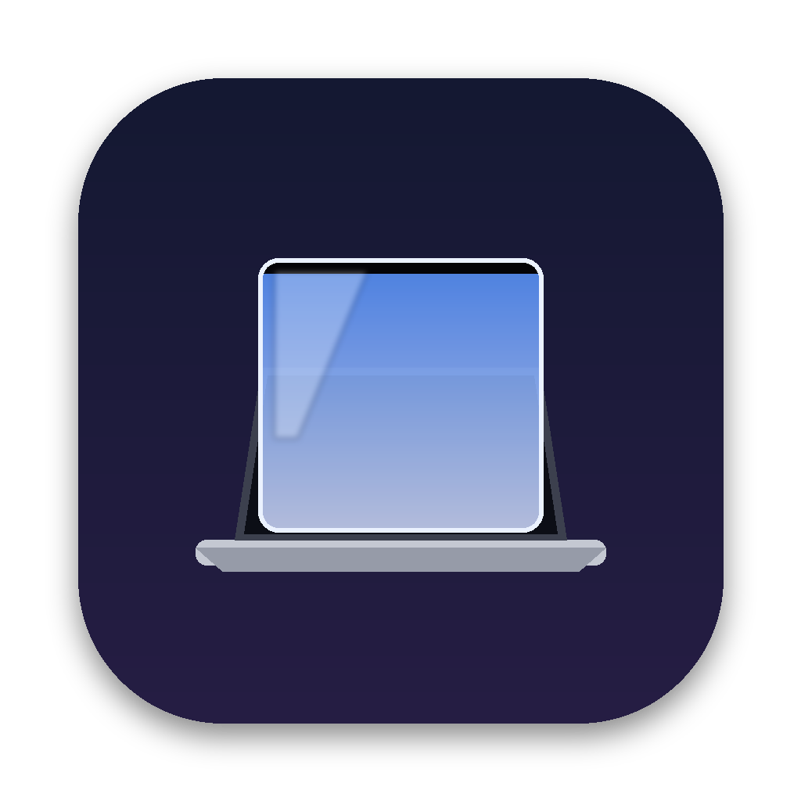
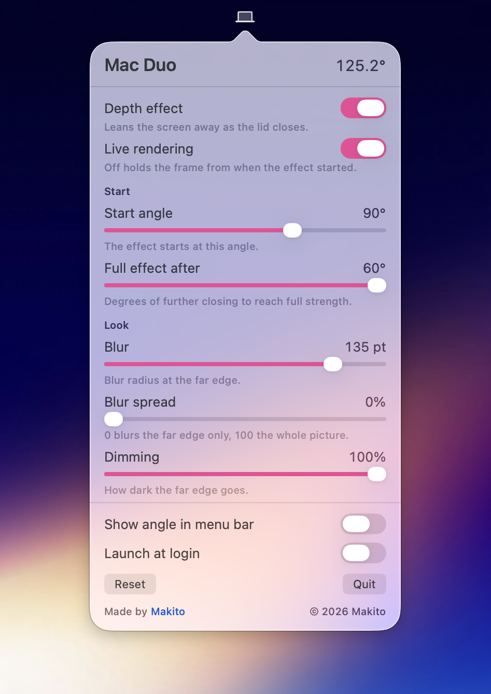

<p align="center">
  
</p>

<h1 align="center">MacDuoNext</h1>

<p align="center">
  <b>Close your MacBook's lid and the screen stays where it was.</b><br>
  A ray-traced glass effect that follows your head, all on your Mac.
</p>

<p align="center">
  <sub>By <a href="https://issen.kurokamicorp.com/"><b>Issen Software Group</b></a> · based on <a href="https://github.com/sumimakito/Mac-Duo">Mac Duo</a> by Makito</sub>
</p>

<p align="center">
  <a href="https://www.paypal.com/donate/?business=juanesgtgt2%40gmail.com&no_recurring=0&item_name=Issen+Software+Group">
    
  </a>
</p>

---

## What it does

Fold an iPhone Duo-style phone and the picture seems to stay put while the
glass moves. MacDuoNext brings that to the MacBook lid. As you close the lid
past a set angle, what was on screen stays standing where the screen used to
be, under a sheet of real-looking cover glass. It blurs and darkens as the
lid comes down, and it follows your head so the picture holds still in the
room.

- **A real 3D scene.** The screen becomes a display panel under a slab of
  glass with rounded corners and a polished, rolled edge. Each frame is ray
  traced: light refracts through the glass, reflects off it (more strongly at
  grazing angles, as real glass does), and picks up a faint green tint along
  the edges.
- **Uses the ray tracing hardware in Apple silicon.** The glass sits in a
  Metal acceleration structure, so M3 and later Macs trace it in hardware.
  Earlier Apple silicon traces it on the GPU, and Intel Macs get an analytic
  version of the same glass.
- **Head tracking.** While the lid is closing, the built-in camera finds your
  face and the picture is drawn from where your eyes actually are, so it looks
  frozen in place. If you step away, it holds for a moment and then drifts back
  to the centre, slowly and smoothly.
- **Private by design.** Faces are found by Apple's Vision framework, on the
  Neural Engine. Nothing is downloaded, no video is saved, and nothing leaves
  your Mac.
- **Light on battery.** The camera turns on only once the lid passes the
  start angle and turns off when it closes. The GPU only draws while the
  effect is on screen.
- **Lives in the menu bar**, with a System Settings-style panel.
- **Interface in 3 languages:** English, Spanish and Simplified Chinese.

<p align="center">
  
</p>

> **MacDuoNext** is made by [**Issen Software Group**](https://issen.kurokamicorp.com/). It is a fork of
> [Mac Duo](https://github.com/sumimakito/Mac-Duo) by Makito, which wrote the original lid
> sensor reader, screen capture pipeline and depth effect. MacDuoNext rebuilds the effect on a
> ray-traced 3D engine, adds head tracking and a new settings panel, and ships under its own
> name and bundle identifier. See [NOTICE.md](NOTICE.md).

---

## Install

1. Download the latest **MacDuoNext .dmg** from the
   [Releases page](https://github.com/AA-EION/MacDuoNext/releases).
2. Open it and drag **MacDuoNext** into **Applications**.
3. Open MacDuoNext from your Applications folder. A laptop icon appears in the menu bar.
4. Allow **Screen Recording** when macOS asks. The effect draws what's on your screen, so it
   needs this.
5. For head tracking, click the menu bar icon, then **Allow Camera Access…**.

Requires macOS 14 Sonoma or later on a MacBook with a lid angle sensor (most recent
MacBooks have one). Universal app for Apple Silicon and Intel.

> **Test builds (marked "Pre-release")** aren't signed by Apple yet, so macOS will refuse to
> open them the first time. After copying the app to Applications, go to
> **System Settings › Privacy & Security** and click **Open Anyway**. You can also run this
> in Terminal instead:
> `xattr -dr com.apple.quarantine /Applications/MacDuoNext.app`

### Updating

Download the new .dmg and replace the app in Applications. Test builds are signed ad hoc, so
macOS may ask for Screen Recording and Camera permission again after an update.

### Coming from Mac Duo

MacDuoNext has its own identity (`com.macduonext.app`), so it installs **next to** Mac Duo
instead of replacing it. Quit Mac Duo and remove it first, so the two don't both draw over
your screen.

---

## Using it

Close the lid slowly past the **start angle** (90° by default). The screen content stays
upright under the glass while the lid comes down, blurring and dimming the further it goes.
Open the lid again and the picture settles back into the screen.

Click the menu bar icon for the panel:

| Section | What's there |
|---|---|
| **Effect** | Turn the effect on or off, and choose between a live picture and the frame from when it started |
| **Head Tracking** | Turn tracking on or off, grant camera access, and see what the tracker is doing |
| **Glass** | Turn the glass on or off, and set how much of the room it reflects |
| **Start** | Start angle, how far to close for the full effect, and an optional timeout |
| **Look** | Blur and dimming strength and spread |
| **Perspective** | How far the picture leans back, and the viewing distance used when no face is tracked |

**Preview** at the bottom plays the effect once without moving the lid.

### Head tracking and privacy

- The camera **only runs while the effect is on**: from the moment the lid passes the start
  angle until it closes, or the effect ends. The green camera light shows exactly when.
- Faces are found by Apple's built-in **Vision** framework, running on the **Neural
  Engine**. There's no model to download and no network access.
- Only the position of the largest face is kept, in memory, for the current frame. No image
  is stored or sent anywhere.
- With **Reduce Motion** on (*System Settings › Accessibility › Display*), head tracking stays
  off and the picture is drawn from the centre.
- If your face leaves the camera's view, for example when the lid gets low enough that the
  camera points at the keyboard, the view holds for a moment and then glides back to the
  centre over several seconds.

---

## Troubleshooting

| Problem | What to try |
|---|---|
| **"This Mac has no lid angle sensor"** | Only some MacBooks have one. Run `MacDuoNext.app/Contents/MacOS/macduonext-lidprobe` in Terminal to check. |
| **Nothing happens when I close the lid** | Check that **Depth effect** is on and that Screen Recording is allowed in *System Settings › Privacy & Security*. Close the lid slowly past the start angle. |
| **Head tracking says "Off"** | Turn on **Head tracking** and allow camera access. Check that **Reduce Motion** is off. |
| **Status stays "Looking for you"** | Face the camera with your face lit. Very low lid angles point the camera away from you; that's expected. |
| **The effect stops as the lid closes** | macOS sleeps when the lid shuts. The effect ends there. |
| **Anything else** | Logs: `log show --last 5m --predicate 'subsystem == "com.macduonext.app"'`. Include them when you open an [issue](https://github.com/AA-EION/MacDuoNext/issues). |

---

## Common questions

**Does it record my screen or my face?**
No. Screen Recording permission is needed to draw your screen's content back on top of
itself. Camera frames go to the face detector and are dropped right away. Nothing is saved or
sent.

**Does it slow my Mac down?**
When the lid isn't closing, MacDuoNext only reads the lid sensor a few times a second. The
camera and the GPU work only while the effect is on screen.

**Can I use an external webcam?**
No. The geometry assumes the camera sits in the lid above the screen, which is what lets it
cancel out the lid's own movement.

**Why does the picture blur?**
It's meant to look like a screen leaning away from you, the way the iPhone Duo effect does.
You can turn the blur down, or off, in **Look**.

---

## How it works (short version)

```
 lid sensor ──▶ LidController ──▶ effect policy ──▶ GlassOverlay ──▶ GlassRenderer (Metal)
   (IOKit)          │                                    ▲                │
                    │                                    │                ├─ acceleration structure
 camera ──▶ FaceTracker ──▶ eye estimate ──▶ viewpoint ──┘                │  (glass slab mesh)
 (Vision,      (lid-angle-compensated)       (1€ filter,                  └─ ray traced kernel
  Neural Engine)                              slow return)                    + present pass
```

- **Sensor.** The lid angle is read from the built-in HID hinge sensor and kept in a short
  history.
- **The room.** The lid, the frozen picture and your eye share one world space, measured in
  screen points and scaled to millimetres from the panel's physical size.
- **Head tracking.** Vision returns a face box. Its width gives distance and its position
  gives direction. That point is placed in the room using the lid angle **at the moment the
  frame was captured**, interpolated from the sensor history. Because the camera rides on the
  lid, this is what separates your head moving from the lid moving. A 1€ filter takes the
  jitter out, and a critically damped spring moves the eye. The tracked eye and the current
  lid angle predict where your face will appear in the next frame, and the detector searches
  there first.
- **Rendering.** For every pixel, a ray goes from your eye through that point of the real
  screen and on into the room: into the glass slab, refracting, partly reflecting, and onto
  the frozen panel. The panel is a mipmapped Gaussian pyramid, so the blur is one sample.
  At the start angle the glass fades out completely, so the overlay appears and disappears
  without a visible seam.

---

## For developers

### Building

You need macOS 14 or later and **Xcode 16** or newer (Swift 6 toolchain).

```bash
# Universal app, DMG and ZIP in dist/, with all tests
./scripts/build-release.sh

# Native build, signed, and relaunched
./scripts/build-release.sh --run

# Tests only
swift test
```

Local builds are signed ad hoc. To sign with your own certificate:

```bash
export MACDUONEXT_SIGN_IDENTITY="Developer ID Application: Your Name (TEAMID)"
./scripts/build-release.sh
```

### Layout

| Target | What it is |
|---|---|
| `MacDuoNextLidKit` | Lid angle sensor (IOKit HID) |
| `MacDuoNextCore` | Geometry, glass mesh, effect policy, eye estimation, viewpoint control. Uses no Apple frameworks, so it is fully unit tested. |
| `MacDuoNextEngine` | Metal engine: acceleration structure, ray-traced kernel, analytic fallback |
| `MacDuoNextVision` | Camera and face detection |
| `MacDuoNextApp` | The menu bar app |
| `macduonext-lidprobe` | Sensor diagnostic tool |

### Releases

Push a `v*` tag. A tag with a suffix (`v1.0.0-beta.1`) publishes a prerelease, which may be
built without signing secrets. See [.github/workflows/release.yml](.github/workflows/release.yml).

To publish a test build straight from a branch, push a commit whose message contains
`[prerelease]`. CI builds and tests it, then publishes it as `v<VERSION>-beta.<run>` on that
exact commit ([.github/workflows/ci.yml](.github/workflows/ci.yml)).

---

## Support & Donations

MacDuoNext is free and open-source software. If it has been helpful to you, consider supporting its ongoing development:

<p align="center">
  <a href="https://www.paypal.com/donate/?business=juanesgtgt2%40gmail.com&no_recurring=0&item_name=Issen+Software+Group">
    
  </a>
</p>

* **PayPal**: [Donate via PayPal](https://www.paypal.com/donate/?business=juanesgtgt2%40gmail.com&no_recurring=0&item_name=Issen+Software+Group)
* **PayPal Email**: `juanesgtgt2@gmail.com`

The original author of Mac Duo, Makito, also accepts [sponsorships](https://github.com/sponsors/sumimakito).

---

## License

Apache License 2.0, see [LICENSE](LICENSE).
Copyright © 2026 Issen Software Group. Copyright © 2026 Makito (the original
[Mac Duo](https://github.com/sumimakito/Mac-Duo)). See [NOTICE.md](NOTICE.md) for attribution.
